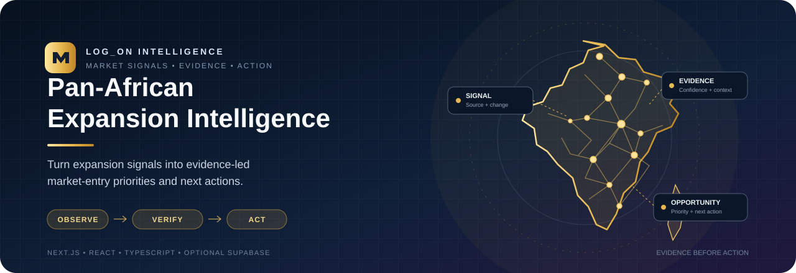
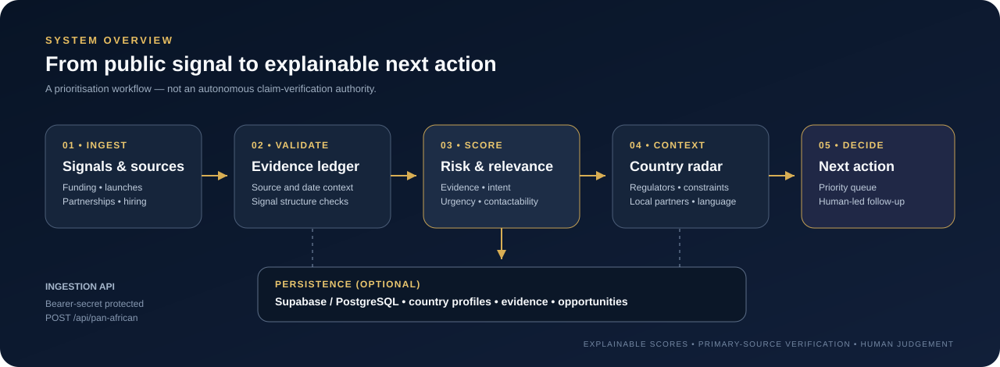

<p align="center">
  
</p>

<p align="center">
  <strong>Evidence-led market-entry intelligence for Africa's connected markets.</strong><br/>
  Turn expansion signals into country context, explainable priorities and practical next actions.
</p>

<p align="center">
  <a href="https://github.com/Logonotobscurity/pan-african-expansion-intelligence/actions/workflows/ci.yml"></a>
  
  
  
  
</p>

## What it does

Pan-African Expansion Intelligence is a standalone LOG_ON web application for collecting and prioritising signals that may indicate business expansion, market-entry activity or infrastructure investment. It connects each signal to supporting evidence, target countries, potential constraints, public partner paths and a suggested implementation workstream.

> **Data note:** the bundled records are development/demo fixtures. A score is a prioritisation aid, not proof that a reported event is true or that a company will enter a market. Verify material claims against primary sources before making business, legal or regulatory decisions.

## At a glance

- **Expansion signal queue:** funding, acquisitions, partnerships, launches, payment infrastructure, hiring and other expansion-related events.
- **Explainable scoring:** evidence confidence, expansion intent, commercial relevance, urgency and contactability.
- **Country radar:** country profiles, authority anchors, verification tracks and common constraints.
- **Evidence ledger:** source URL, source type, publication/retrieval dates, reliability rating and what the source supports.
- **Opportunity translation:** converts a signal into a possible LOG_ON deliverable, likely buyer and next action.
- **Protected ingestion API:** accepts validated signal payloads with a bearer secret.
- **Optional persistence:** Supabase/PostgreSQL adapter with a schema in `database/pan_african_expansion.sql`.

## Architecture

<p align="center">
  
</p>

The application separates the data model and scoring rules from the dashboard UI. In development, the queue is populated from fixtures; when Supabase is configured and the schema is applied, the app can read and persist signal payloads.

| Layer | Responsibility |
| --- | --- |
| Signal model | Canonical signal, market, evidence, relationship and constraint types |
| Validation and scoring | Input checks, deduplication, confidence/intent/commercial/urgency/contactability scoring |
| Country context | Country profiles, regulator/authority anchors and verification tracks |
| Dashboard | Queue summary, country radar, signal details and evidence links |
| Ingestion API | Authenticated `POST /api/pan-african` endpoint |
| Persistence adapter | Optional Supabase REST access for stored signals and related records |

## Quick start

### Prerequisites

- Node.js 20 or newer
- npm (included with Node.js)
- Optional: a Supabase project for persistent storage

### Install and run

```bash
git clone https://github.com/Logonotobscurity/pan-african-expansion-intelligence.git
cd pan-african-expansion-intelligence
npm install
cp .env.example .env.local
npm run dev
```

Open [http://localhost:3000](http://localhost:3000). The root route redirects to `/pan-african`.

On Windows PowerShell, use `Copy-Item .env.example .env.local` in place of `cp`.

### Environment variables

| Variable | Required for | Notes |
| --- | --- | --- |
| `NEXT_PUBLIC_SUPABASE_URL` | Persistence | Supabase project URL. |
| `SUPABASE_SERVICE_ROLE_KEY` | Persistence | Server-side secret. Never put it in client-side code or commit its value. |
| `EXPANSION_INGEST_SECRET` | API ingestion | Shared secret required in the `Authorization: Bearer …` header for POST requests. |

Without Supabase configuration, the dashboard uses included development fixtures. To enable persistence, configure the two Supabase variables and apply `database/pan_african_expansion.sql` to the project database. Review the schema and database policies before applying it to production.

## API

### Read the current queue

```bash
curl http://localhost:3000/api/pan-african
```

The response includes the mode, generation timestamp, persistence flag and scored signal queue.

### Ingest signals

Set `EXPANSION_INGEST_SECRET` on the server first. Then send a non-empty JSON array of signal objects, or an object containing a `signals` array:

```bash
curl -X POST http://localhost:3000/api/pan-african \
  -H "Content-Type: application/json" \
  -H "Authorization: Bearer $EXPANSION_INGEST_SECRET" \
  --data @signals.json
```

The endpoint returns `401` without valid authorization, `400` for invalid JSON or an empty signal list, `422` for failed signal validation, and a server error if persistence is configured incorrectly. Do not expose the ingestion secret to a browser client.

Each signal should include an ID, company, signal type, market references, a description of what changed, constraints, evidence and relationships. The authoritative contract is defined by the TypeScript interfaces and `validateSignal` in `lib/panAfricanExpansionIntelligence.ts`.

## How the score works

The composite score is a weighted prioritisation score, not a probability:

| Dimension | Weight | What it helps rank |
| --- | ---: | --- |
| Evidence confidence | 25% | Strength and reliability of the available source evidence |
| Expansion intent | 20% | Explicit target markets and observed expansion activity |
| Commercial relevance | 30% | Fit between the signal and a potential implementation need |
| Urgency | 15% | Recency of the material signal |
| Contactability | 10% | Confidence and availability of public partner/contact paths |

The factors remain visible in the signal detail so an operator can challenge the ranking instead of treating the total as a black-box verdict.

## Quality checks

```bash
npm run typecheck
npm run build
```

The GitHub Actions workflow runs type-checking and a production build on pushes and pull requests. Its badge at the top reports the workflow's actual status.

## Capture a real UI demo

A real recording is not embedded yet because there is no verified, publicly reachable app preview URL in this repository. Once a preview is deployed, [screencli](https://screencli.sh/docs/cli) can record the live UI and export a compact GIF:

```bash
npx screencli record https://YOUR-PREVIEW-URL -p "Open Pan-African Expansion Watch, show the summary metrics and country radar, filter to Kenya, expand a signal, and show its market-entry workstream and evidence ledger."

# After recording, use the output directory printed by screencli:
npx screencli export ./recordings/RECORDING-DIRECTORY --preset github-gif
```

Review the exported clip before committing it to `docs/assets/`. Keep it short, ensure text remains readable at README display size, and avoid recording secrets or private user data. Replace the placeholder URL with a reachable deployed preview URL.

## Project structure

```text
app/
  api/pan-african/route.ts      # GET queue / protected POST ingestion
  pan-african/page.tsx          # Server-rendered dashboard data selection
components/
  pan-african-expansion-dashboard.tsx
database/
  pan_african_expansion.sql     # PostgreSQL/Supabase schema
docs/assets/
  pan-african-banner.svg
  architecture.svg
docs/
  PAN_AFRICAN_EXPANSION_IMPLEMENTATION.md
lib/
  panAfricanCountryProfiles.ts
  panAfricanExpansionFixtures.ts
  panAfricanExpansionIntelligence.ts
  panAfricanExpansionRepository.ts
  panAfricanExpansionService.ts
```

## Security and operational notes

- Keep `SUPABASE_SERVICE_ROLE_KEY` and `EXPANSION_INGEST_SECRET` server-only.
- Use least-privilege database policies and review the SQL schema before production rollout.
- Treat seeded records and generated scores as decision-support examples until sources and claims are verified.
- Recheck local payment, licensing, data-protection, tax and entity-entry requirements with the relevant primary authority.
- Do not ingest confidential contact data or information you are not authorised to process.

## Contributing

Issues and pull requests are welcome. For changes to scoring or validation, include examples that demonstrate the expected result and explain any changes to prioritisation semantics. For UI changes, verify responsive layouts and capture a short browser demo when a reachable preview is available.
